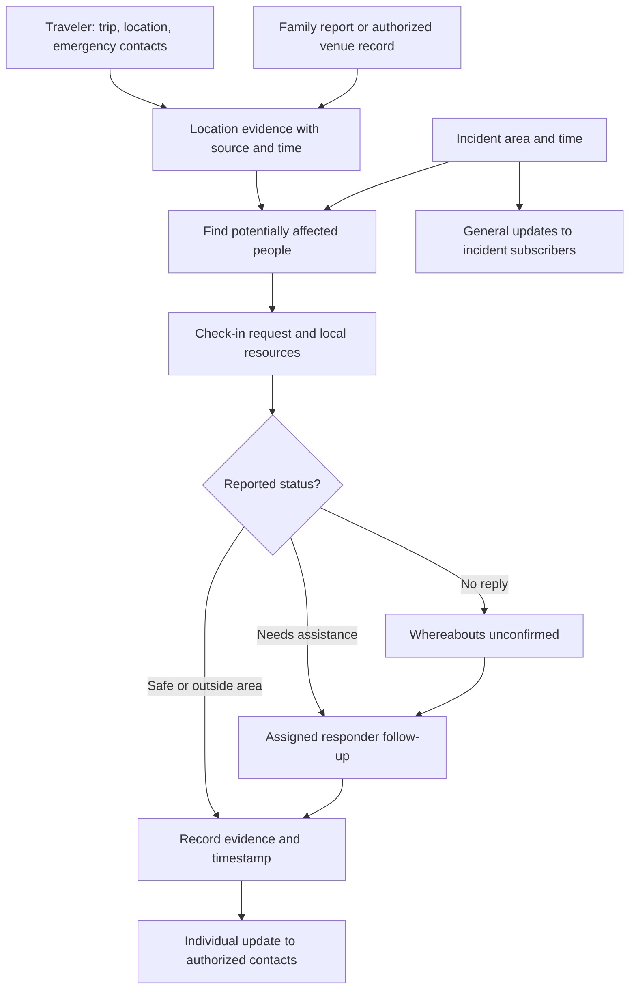

# Together: 16-Hour Hackathon Build and Presentation Plan

> **Superseded in places (2026-10-30).** This plan is out of date. Go by [GLOSSARY.md](GLOSSARY.md), [docs/adr/](docs/adr/) and the spec instead. Main changes:
> - Family members can't report people who never signed up; they go to law enforcement ([ADR-0002](docs/adr/0002-no-third-party-missing-person-reports.md)).
> - "Responder" now means field crews; the Coordinator is a human at a desk.
> - The AI now drafts Potential incidents and Urgency levels, and no longer links people.
> - The submission is a 2–3 minute video, due 10:00 a.m. Saturday, not a live pitch. Feature freeze is 8:00 a.m.
> - The track is Community.

Prepared for a three-person team. This is a proposed build plan; the application and checks described here have not been implemented or run as part of this document.

## 1. The project you are building

Together is a disaster accountability and resource map for public places. It combines self-reports, optional device location, confirmed itinerary details, authorized venue records, and family reports to help coordinators identify people who may be affected, request check-ins, share resources, and track follow-up.

The complete demonstration should follow one person from a trip plan to a family update and a responder case outcome. A person can be represented even when they did not register before the incident, through a venue record or someone else's report. Coverage remains partial in an open public place.

Suggested track: Governance & Collaboration, because the central product is coordinated action and accountable decisions. Confirm the organizers' track descriptions at kickoff.

The current Dartmouth event page describes a 24-hour event and emphasizes how projects support human judgment. This plan intentionally budgets only the 16 hours you requested. The five-minute presentation below is an assumption; adapt it to the actual judging slot. No numerical judging weights have been verified.

## 2. Freeze this scope before coding

| Priority | Deliverable | Smallest working version |
| --- | --- | --- |
| Core | Incident and resource map | One synthetic incident polygon and a small, clearly labeled fictional resource dataset |
| Core | Traveler registration | Name, optional manual map pin, trip text, and one emergency contact |
| Core | AI itinerary extraction | Pasted text becomes editable stops and time windows; user confirms before saving |
| Core | Potentially affected list | Explicit place-and-time rules create cases with an explanation of the evidence |
| Core | Check-ins | Reported safe, needs assistance, and not in area |
| Core | Family reporting | Report someone believed to be in the incident area, including someone with no account |
| Core | Emergency-contact updates | In-app individual updates for a prelinked authorized demo contact |
| Core | General updates | A separate incident feed for subscribers |
| Core | Responder workflow | View evidence, claim a case, log contact, and record an outcome |
| After core works | Venue records | One CSV format and a small synthetic tour manifest |
| After core works | Device location | Explicit consent, visible timestamp, accuracy, and a stop-sharing action while the page is open |
| Stretch | AI candidate linking | Explain possible links between a family report and existing evidence; coordinator approves |

Keep SMS delivery, native background tracking, offline synchronization, live institutional integrations, predictive flood modeling, route safety, facial recognition, and automated rescue decisions for later development. Show planned capabilities accurately in the pitch.

## 3. Prepare one demonstration story

Use a fictional incident in a visitor corridor, a fixed demo date and timezone, and 20 synthetic people. Display a visible simulation label. Use three authenticated demo accounts: traveler, authorized family contact, and incident coordinator. Keep an unrelated family account available for the access-control check.

Maya is visiting a canyon. She pastes: "On the demo date, I will be at the visitor center from 7:00 to 8:00, then at Phantom Ranch from 13:00 to 16:00." The app extracts the stops. Maya confirms the named landmarks and times, and her designated contact is already linked in the demo setup.

A coordinator activates a synthetic flash-flood incident overlapping Phantom Ranch at 13:30. Together creates a case labeled "Planned visit overlaps incident; current whereabouts unconfirmed" and delivers an in-app check-in request. Maya's contact receives the general incident update.

Maya's contact reports that they cannot reach her. The report appears in the coordinator's queue. A suggested link, or a manual review in the core version, connects it to Maya's existing case. The coordinator confirms the connection.

A judge acting as Maya chooses "I need assistance" and adds a short fictional need. The responder view updates, a coordinator claims the case, and the family sees the assistance-request update. The coordinator later records confirmed contact and assistance provided, with a source and time. A separate synthetic traveler remains unconfirmed to show that no reply is handled honestly.

The itinerary drives the remote disaster scenario. If you demonstrate actual device location in Hanover, show its real position separately; it should not be presented as a Grand Canyon location. A manual demo pin must be labeled as simulated or self-reported.

## 4. Divide the team by ownership

| Owner | Main responsibility | Deliverables |
| --- | --- | --- |
| A: traveler and family experience | Forms, status buttons, contact page, presentation narrative | Traveler page, family missing-person form, update feed, demo instructions |
| B: shared data and responder workflow | Database, authentication, server authorization, case events, notifications, deployment | Working shared state, coordinator queue, case assignment, contact visibility, reset process |
| C: map and AI | Map, itinerary extraction, editable confirmation, incident matching, resources | Map layers, parsed stops, explicit matching explanations, validated server-side AI call |

Choose owners according to existing skills. Agree on record shapes and action names before parallel work. Each person owns their main files; announce interface changes immediately. Name one integration owner, preferably B, for deployment and shared contracts.

## 5. The 16-hour schedule

Times are elapsed time from your actual coding start, not clock times.

| Elapsed time | Work | Required checkpoint |
| --- | --- | --- |
| 0:00-0:45 | All: agree on one story, required screens, statuses, role permissions, sample date/timezone, and API record shapes | Written scope and one example record per main action |
| 0:45-2:00 | A: forms and page shell. B: database, authenticated demo accounts, deployment. C: map with known landmarks and polygon | Hosted page loads and the first record can be saved and read |
| 2:00-5:00 | A: check-in and contact feed. B: case events, responder queue, notification records. C: map reads shared records and shows incident/resources | A check-in on one device changes the responder view on another |
| 5:00-8:00 | A: editable itinerary confirmation and emergency-contact UI. B: place/time matching endpoint and recipient rules. C: AI extraction and map stop selection | Pasted trip text becomes confirmed stops and creates an explained incident case |
| 8:00-10:00 | A: family missing-person form. B: report queue, manual case linking, general/individual update separation. C: report summary and matching explanation | Family report can enter without prior traveler registration; linked contacts receive the correct updates |
| 10:00-11:30 | Add fixed-format venue CSV and foreground device location if core is stable. Polish source/time labels and assistance details | Every retained feature is integrated into the shared system |
| 11:30-13:00 | All: run acceptance cases, fix permissions and incorrect statuses, handle AI/geolocation failures | Full story works across separate accounts; unrelated users cannot read private cases |
| 13:00-14:00 | Freeze features, verify the public demo URL, record a backup walkthrough, prepare submission assets | Deployable release, repeatable reset, backup video, README |
| 14:00-16:00 | Rehearse timed pitch, run judge interaction, assign Q&A, submit before deadline | Three consecutive successful rehearsals and completed submission |

Protect the last three hours. Use short integration checkpoints around hours 2, 5, 8, 10, and 13. Take food and rest breaks in turns so the shared build remains coordinated.

## 6. Build in this dependency order

1. Make shared data and access rules work. Create test identities and link only the intended contact to Maya.
2. Build a status change from traveler to responder to family. This is the first complete working flow.
3. Put the same records on a map. Add a fixed incident polygon and fictional resource markers.
4. Make incident matching explainable. Show which report and time window caused a person to be included.
5. Add itinerary extraction, review, and confirmation. A failed AI call falls back to the manual stop form.
6. Add a family report for someone not already registered. Keep it as its own report until reviewed.
7. Add general incident updates and individual notifications with separate recipients.
8. Add the venue CSV and optional foreground GPS only after the complete story works.
9. Add suggested person linking if time remains. Manual review and linking remain available.
10. Test, freeze, record, and rehearse.

Do not wait until the end to connect independently designed screens. Every visible count, case, pin, and notification should come from the shared records.

## 7. Screens and visible information

| Screen | Essential elements |
| --- | --- |
| Incident map | Simulation label, incident boundary, resources with source/time, own reported or planned locations, accessible list alternative |
| Traveler page | Trip text, extracted stops to confirm, emergency contact, optional location permission, check-in actions |
| Family page | General incident feed, authorized person's status timeline, missing-person report form |
| Coordinator page | Case queue, evidence source/time, contact attempts, assistance needs, owner, suggested matches, action history |

Keep actions visibly distinct: request a check-in, record a report, confirm contact, and resolve assistance are different events. Use text labels as well as colors. Show resources' stated availability and source; do not label a place or a route safe merely because it is nearby.

## 8. Suggested technical approach

Use the framework your team already knows. If that is React, a workable combination is React/Vite for the interface, Leaflet for mapping, Supabase for shared data and authentication, a server-side endpoint for AI, and Turf for point-in-polygon checks.

Start with short polling for shared updates if realtime subscriptions are unfamiliar. Use structured AI output with server-side validation. Keep credentials and privileged operations on the server. Use server-side checks and database policies for private records; a hidden UI button is not authorization.

For the map, use an appropriate basemap provider and its required attribution. Keep a list fallback if external tiles fail. Resolve itinerary names against a small supplied catalog of demo landmarks; request a user selection when a place is unclear. This avoids spending the sprint building worldwide geocoding.

Keep the prototype's notification mechanism in-app. The demo should show that the event reaches the correct authenticated recipient. Automated SMS/email delivery and verified contact invitations are later extensions; the demo uses explicitly prelinked fictional accounts.

## 9. Minimal shared records

| Record | Important fields |
| --- | --- |
| Person/profile | Stable person ID, display name, optional account ID; records can represent someone without an account |
| Contact link | Person ID, contact account ID, allowed update scope, active/verified state |
| Incident | ID, description, boundary, start/end time, source, simulation flag |
| Report | Reporter, report type, optional person link, original text, location/time evidence, source, creation time |
| Case | Incident, optional person ID, current reported status, assignment, last action |
| Case event | Case ID, action, actor, source report, event time, recorded time, notes |
| Resource | Incident, coordinates, service type, stated accessibility/availability, source, last update |
| Notification | Recipient, incident or case, event ID, general/individual type, created/read time |

Trip stops and CSV import details can use structured JSON within reports for the prototype. Avoid building a complex geospatial database. A case can initially refer to an unidentified person or unlinked report. Matching records should not silently erase original evidence.

## 10. Rules for location, status, and matching

- Keep reported location, device location, planned location, venue presence evidence, and witness evidence distinct.
- A trip stop becomes eligible only after the user confirms its place and time. A missing date or timezone requires clarification, not a guess.
- Compare both location and time with the incident. Treat uncertain boundary cases as possible/unknown rather than confidently excluding someone.
- A planned stop in the polygon creates a possibly affected case, not a claim that the person is physically present.
- Keep old GPS points as last-known evidence with age and accuracy visible. Do not infer movement along an itinerary.
- A family report can be labeled reported missing while its identity and whereabouts remain unconfirmed.
- No reply stays unconfirmed. A report from a companion retains that attribution.
- A responder records what was established: contact confirmed, assistance provided, outside incident area, duplicate after review, or unresolved.
- Store actor, evidence, and time for changes. A correction creates a new event so the earlier history remains understandable.
- Deduplicate case creation by incident and confirmed person ID. Suggested name matches need review.
- Public users see resources and general information. Contacts see only the people whose details they are authorized to receive. Responders see the cases authorized for their incident.
- Location sharing has an explicit stop control. Expiry/revocation should stop future sharing; real deployments need a defined retention and emergency-access policy.

## 11. Give AI two bounded jobs

First, extract itinerary details: place text, date/time window, timezone if provided, source excerpt, missing fields, and whether clarification is required. The user confirms the output before it creates location evidence. Model-supplied coordinates should not become trusted positions.

Second, if time permits, suggest related reports. Return candidate case IDs, matching details, conflicting details, and a short source-linked explanation. Avoid arbitrary percentages that look like calibrated identity confidence. A coordinator decides whether to link the records.

Use normal code for geographic checks, time overlap, contact permissions, case assignment, and notification recipients. Structured output constrains format; it does not establish that the extracted facts are correct.

Treat uploaded itineraries and reports as untrusted input, including text that resembles instructions to the model. Accept only the expected output fields, verify quoted evidence exists in the input, and provide a manual correction path.

## 12. Flow of the product

## 13. Acceptance checks before feature freeze

These are planned checks, not completed results. Keep a small checklist with actual pass/fail observations.

| Check | Required behavior |
| --- | --- |
| Confirmed itinerary overlaps event | Creates an explained possibly affected case |
| Same location, different day | Does not create a misleading current exposure claim |
| Missing date or ambiguous landmark | Requests clarification and preserves the original text |
| Old device location | Shows last-known time; does not call it current |
| Two people with the same first name | Preserves separate cases pending review |
| Family report for a non-user | Creates a report and follow-up case without requiring prior registration |
| No response | Remains unconfirmed |
| Authorized contact | Receives permitted personal updates |
| Unrelated signed-in account | Cannot read another person's private case through direct API queries |
| General subscriber | Receives incident updates without private person data |
| Location permission denied/stopped | Manual reporting remains usable; new location collection stops |
| AI timeout or invalid extraction | Shows retry/manual entry and does not create false location evidence |
| Two separate sessions | Status changes and notifications propagate from the actual shared data |
| Duplicate activation/import | Does not create repeated cases or duplicate notifications for the same event |
| Reset and rerun | Restores the fixture story without affecting unrelated records |

If practical, time one unfamiliar person's path from receiving a check-in request to submitting a status. Report only measurements you actually obtained. Synthetic checks do not establish real-disaster reliability or real-world lives saved.

## 14. Five-minute presentation

| Time | Show | Say or establish |
| --- | --- | --- |
| 0:00-0:25 | One map or simple problem visual | A family knows a traveler planned to visit; coordinators have scattered records; nobody has a shared current status |
| 0:25-0:45 | One-sentence product description | Together connects trip plans, check-ins, family reports, resources, and responder follow-up |
| 0:45-1:20 | Paste itinerary, review stops | Demonstrate the AI doing useful work and the person confirming uncertain details |
| 1:20-1:55 | Activate simulation; show candidate case | Explain planned location versus confirmed presence; show the resource/check-in message |
| 1:55-2:30 | Judge submits an assistance request | Make the interaction easy: one QR link and one action |
| 2:30-3:05 | Responder claims case; contact feed updates | Complete the loop across traveler, coordinator, and authorized family |
| 3:05-3:35 | Show unresolved or ambiguous second case | Explain why no reply stays unknown and a possible identity match needs review |
| 3:35-4:10 | Compact architecture or workflow visual | AI extracts and suggests; explicit rules handle geography/permissions; people verify and act |
| 4:10-4:40 | Actual checks and prototype boundaries | State what works today, what is simulated, and the next validation step |
| 4:40-5:00 | Resolved main case beside family update | Close on the outcome: information has a source, follow-up has an owner, family gets the permitted update |

One person narrates the story and handles the opening/close. One operates the app. One helps the judge with the phone and handles technical questions. Keep verbal handoffs short. Your EMS experience can inform the explanation of handoffs and accountability; distinguish personal observations from validation you have not conducted.

Suggested opening: "After a flash flood, a family may know where someone planned to go, while coordinators have scattered visitor records and witness reports. Together brings those clues into one reviewable case, asks for a check-in, and tracks who is following up."

Suggested theme statement: "AI reads the scattered information and proposes connections. People confirm uncertain details, decide what action is appropriate, and remain accountable for the outcome."

Suggested close: "We built the path from a trip plan to a responder action and a family update. Our next step is to test that workflow with the people who would actually operate it."

If the slot is only two minutes: 15 seconds for the problem, 70 seconds for the full story, 20 seconds for human judgment and uncertainty, and 15 seconds for limits and next steps. Keep additional screens for questions.

## 15. Supporting slides and demo preparation

Prepare up to five simple slides: problem; users and workflow; AI and human responsibilities; measured checks and limitations; next validation step. The working application should occupy most of the presentation.

Prepare a short backup recording of the same story with visible synthetic-data labels. Keep a fallback to manual itinerary entry if the AI service fails. A recording or cached result must be identified as such. Do not claim a failed live feature worked.

Before judging: sign into the separate demo accounts; preload the incident; confirm API access and the hosted URL; charge phones; increase display size; reset the records; and test the judge's QR code on a second device. Avoid displaying a whole room of real contacts or location histories. Use fictional contacts throughout the remote incident demo.

## 16. Likely judge questions

| Question | Answer to prepare |
| --- | --- |
| Why does this need AI? | Plans and reports arrive as human language with inconsistent names, places, and times. AI extracts structured evidence and suggests connections; explicit rules and human review control actions. |
| How is this different from an alert app? | The demonstrated output is a person case with source-labeled evidence, contact history, an assigned follow-up owner, and permitted family updates. Acknowledge that emergency and reunification products already exist. |
| What happens without phone service? | The prototype cannot transmit through a total communications outage. A companion or coordinator can report when connected. Offline queueing and additional channels are future work. |
| What if they never registered? | An authorized venue record, family report, or witness report can create a case. A completely unreported person can remain outside the system's coverage. |
| Does a planned visit mean they are there? | No. It creates a possible-overlap case with the original evidence and time window visible. |
| Could a stranger track someone? | General subscribers see public incident information. Private person updates require an authorized contact link or responder access; a missing-person submission does not grant tracking access. |
| What if AI links the wrong people? | Preserve reports separately, expose conflicts, and require coordinator review. The core workflow can use manual linking. |
| Do you predict floods or dispatch rescuers? | The prototype consumes a defined incident and coordinates information/follow-up. It does not establish route safety or autonomously dispatch rescue teams. |
| What is working versus simulated? | Give the exact list from your final build: real extraction/shared state/status permissions; synthetic incident, people, resources, and venue records; in-app notifications unless external delivery was actually integrated. |
| Who would adopt it first? | A bounded pilot with one tour operator, event venue, campus, or park partner and a designated coordinator. Validate access policies, coverage, and existing response workflows before deployment. |
| How do you measure impact? | Start with extraction errors, incorrect links, time to acknowledge/assign a case, contact update completion, and user comprehension of uncertain statuses. Report only measured prototype results. |

## 17. Feature cutoffs and later work

- If shared traveler-to-coordinator status is not working by hour 5, pause map polish and all extra integrations until it does.
- If itinerary extraction is unstable by hour 8, keep its editable manual fallback and fix one bounded text format. Drop PDF and image parsing.
- If person matching is unstable by hour 10, retain manual search/linking with source evidence. Keep AI itinerary extraction as the principal AI capability.
- If CSV or live GPS threatens integration by hour 11.5, show representative synthetic records and describe unfinished import/tracking work accurately.
- Freeze new features at hour 13. Correctness, clear labels, and a reliable story take priority during the final three hours.

Later additions worth exploring: group count discrepancies; expiring consent; verified contact invitations; SMS/email; offline drafts with clear pending status; accessibility-aware resource filtering; updated check-ins when incident boundaries change; and integration with one partner's authorized visitor records. Choose the next addition based on stakeholder testing, not breadth alone.

## 18. Submission checklist

- Working project link and repository, following the actual event's submission rules.
- Clear title and short description.
- README with setup, architecture, AI role, synthetic-data explanation, limits, and demo steps.
- Demo accounts or access instructions that expose only fictional records.
- Short video if requested or useful as a backup.
- Actual acceptance-check results; no unmeasured accuracy, adoption, or lives-saved claims.
- Required attribution, credits, and disclosure of pre-existing components according to the event rules.
- A reset procedure scoped to the demonstration incident.

## Sources checked

These support the event context and the technical capabilities used in this proposed plan; they do not validate the product's emergency readiness.

- [Dartmouth AI at 70 Student Hackathon](https://ai.dartmouth.edu/ai-70-events/what-must-remain-human-conference/ai-70-student-hackathon): event context and emphasis on human judgment.
- [NPS public assistance request after the Grand Canyon flash flood](https://www.nps.gov/grca/learn/news/public-assistance-requested-to-account-for-individuals-following-grand-canyon-flash-flood.htm): example of collecting public reports to account for potentially affected visitors.
- [Leaflet quick start](https://leafletjs.com/examples/quick-start/): map markers, polygons, popups, and attribution.
- [Supabase row-level security](https://supabase.com/docs/guides/database/postgres/row-level-security): database access controls.
- [Turf point-in-polygon](https://turfjs.org/docs/api/booleanPointInPolygon): geographic inclusion checks.
- [Claude structured outputs](https://platform.claude.com/docs/en/build-with-claude/structured-outputs): schema-constrained AI response formatting.
- [MDN geolocation watchPosition](https://developer.mozilla.org/en-US/docs/Web/API/Geolocation/watchPosition): foreground location integration and permission requirements.
